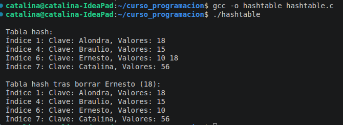

## Tabla Hash

Implementación de la tabla Hash, donde a partir de las funciones de 
insertar, borrar, busqueda y liberación de memoria que permite varios 
valores por llave.
\\
El siguiente corresponde al output:

