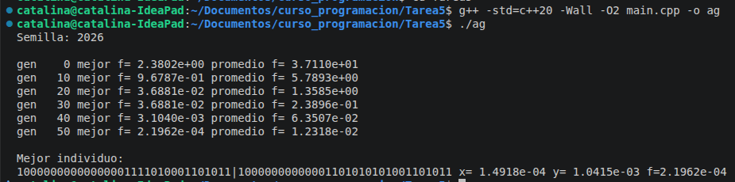

## Tarea 5: Algoritmos evolutivos

ALgoritmo evolutivo con padres de tipo unsigned int de 32 bits en representación binaria bajo la función Rastrigin bajo dos variables.

El método de solución fue que por medio del archivo evolution_algo contruimos las funciones bajo el siguiente paso a paso:

1. Definir individuo
2. Generamos una población aleatoria donde el # de individuos fue 50, % de cruzamiento 0.9, % de mutación 0.1 y 50 generaciones
3. Cruzamiento (seleccionamos dos individuos de forma aleatoria)
4. Mutación a los hijos
5. Evaluamos f a toda la población
6. Ordenamos la ppoblación, así eliminamos los menos aptos (en este caso los más aptos corresponden a los que al evaluar minimicen la función)

Donde obtuvimos el siguiente resultado:  

