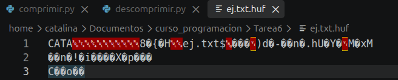

# Tarea 6: Huffman

Para la siguiente tarea 6 se realizarón dos archivos para comprimir.py y 
descomprimir.py archivos por medio del arbol de Huffman, donde 
su funcionamiento es el siguiente:

Comprimir: 
1. Leemos el archivo como bytes
2. Contar las frecuencias
3. Construir el árbol
4. Traducir el archivo a bits
5. Serializar el árbol
6. Escribir el header y los datos

Descomprimir:
1. Leer el header para validar la firma
2. Detectar las secciones
3. Reconstruir el árbol
4. Recorrer el árbol con los bits
5. Verificar tamaño y guardar archivo recuperado
## Uso 
El siguiente corresponde al funcionamiento de los dos códigos: 
```
python comprimir.py <archivo> [salida.huf]
python descomprimir.py <archivo.huf> [salida]
```

## Ejemplo de uso
Para este caso, usamos un archivo en formato .txt llamado ej, donde aparecen 
la compresión con la extensión .huf y al descomprimir se generó 
el archivo recuperado_ej.txt. El siguiente output corresponde al archivo 
comprimido en hexadecimal: 

