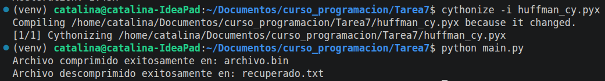
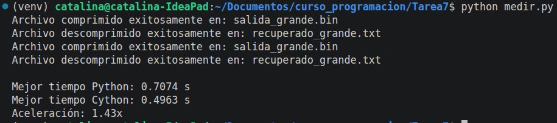

# Tarea 7: Uso de Cython

En la presenta tarea se implementó el uso de cython por medio del código de huffman visto en clase, donde las modificaciones se realizaron en el archivo huffman_cy.pyx y el ejemplo
de uso en el archivo main.py

## Funcionamiento

1. Verificamos la implementación del código Cython `huffman_cy.pyx` por medio de `main.py` para el posterior ejemplo.
2. Para comparar los tiempos de ejecución usamos `medir.py` donde generamos `origen_grande.txt` para las posteriores pruebas.

## Ejemplo de  uso
1. Para verificar la correcta implementación de Cython, se creo el archivo main.py donde se probó mediante el .txt visto en clase llamado "origen", donde los resultados son:

Esta ejecución crea los archivos: archivo.bin, recuperado.txt.

2. Adicionalmente, para la medición de los códigos implementados con python y cython se creo el archivo medir.py que genera un archivo txt grande de forma aleatoria.
Los resultados fueron:

Esta ejecución crea los archivos: salida_grande.bin, recuperado_grande.txt.
